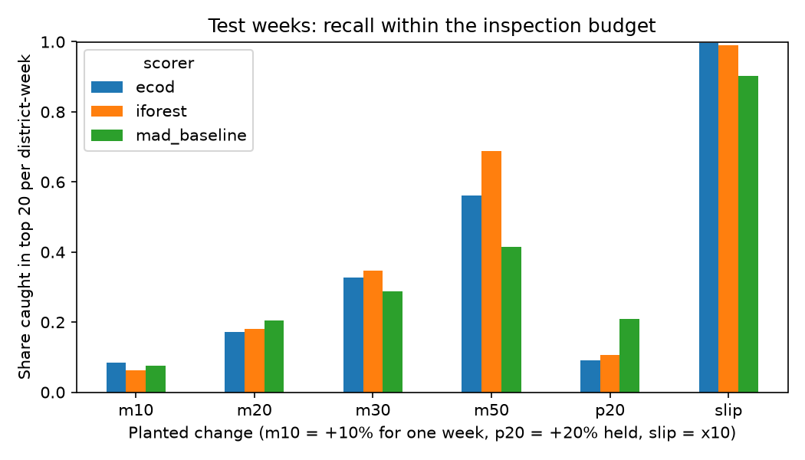
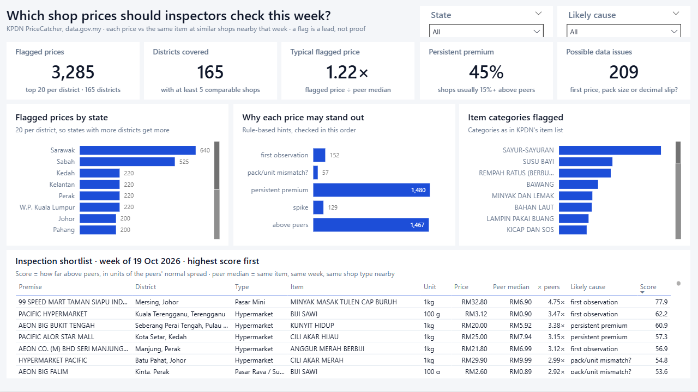
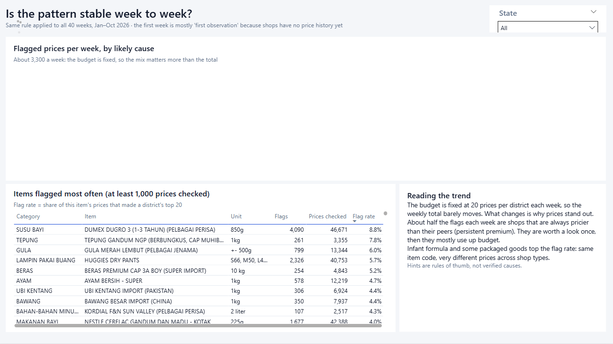
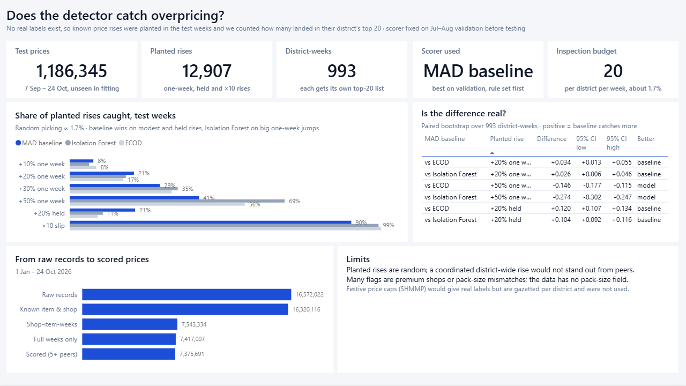

# PriceCatcher anomaly triage

Which shop prices in Malaysia look out of line this week, and which ones should
an inspector look at first?

This project scores every price in KPDN's PriceCatcher open data against
same-week peers and produces a **weekly shortlist of at most 20 prices per
district**. It compares a simple robust-statistics baseline with two
unsupervised ML models (Isolation Forest, ECOD), and tests them honestly on
planted price changes, because the data has no labels for profiteering.
A three-page [Power BI report](#power-bi-report) presents the shortlist, the
trend and the evaluation.

**Result in one line:** the simple baseline is the better shortlist tool. It
catches about twice as many +20% markups held over several weeks as either ML
model (21% vs 9–11%); Isolation Forest is better only at large one-week jumps.

> A flag means "look at this", not "this shop is profiteering". Many flags are
> premium shops, pack-size mismatches or data-entry slips.

## v2: weekly pipeline with calibrated flags

[](https://github.com/Downey112/pricecatcher-anomaly/actions/workflows/weekly.yml)
[](https://github.com/Downey112/pricecatcher-anomaly/actions/workflows/ci.yml)

Every Monday a GitHub Actions job downloads the last two months of PriceCatcher, scores the
latest complete week, and commits a brief to [`results/weekly/`](results/weekly/).

- **Conformal p-values** (`src/pcad/conformal.py`): each price's MAD score is compared with
  200,000 scores from the training weeks. Flagging at p ≤ α means a normal price is flagged at
  most α of the time. Checked on weeks never used for calibration:

  | α | validation flag rate | test flag rate | flags per week (all Malaysia) |
  |---|---|---|---|
  | 0.01 | 0.0099 | 0.0098 | ~1,900 |
  | 0.001 | 0.0011 | 0.0011 | ~210 |
  | **0.0001 (used)** | 0.00010 | 0.00009 | ~18 |

- **Brief** (`src/pcad/brief.py`): a Markdown table of the strongest flags. With `GROQ_API_KEY`
  set, an LLM writes a summary, which is rejected (falling back to the table) if it contains a
  number that is not in the flagged rows or cites a row that does not exist.
- **MLflow** (`scripts/07_weekly.py`): each run logs α, counts, flag rate and the brief, to a
  local SQLite store (uploaded as a workflow artifact) or any server set in `MLFLOW_TRACKING_URI`
  (e.g. DagsHub).

```bash
python scripts/00_download.py --months 2   # latest two months only
python scripts/01_build.py
python scripts/07_weekly.py --alpha 0.0001
```

Design notes: [EXPLAIN.md](EXPLAIN.md).

## Data

- **Source:** KPDN PriceCatcher via [data.gov.my](https://data.gov.my/data-catalogue/pricecatcher),
  licence CC BY 4.0. Monthly parquet files plus item and premise lookups.
- **Period:** 1 Jan – 24 Oct 2026, **16,572,022 price records**.
- **Cleaning** (counts in `results/build_counts.json`):
  - 251,893 rows (1.5%) had item codes missing from the item lookup and 13 had
    unknown premises; both dropped.
  - Prices are aggregated to one weekly median per premise and item:
    7.54M premise-item-weeks.
  - 3 partial weeks dropped (fewer than half the usual records): the week of
    29 Dec 2025, the Chinese New Year week (16 Feb) and the week of 5 Oct
    (no data 1–9 Oct). That removes 126,327 premise-item-weeks, leaving 7.42M.
  - 41,316 rows dropped because no peer group had at least 5 shops.
  - Final: **7,375,691 rows over 40 weeks, 16 states.**

A premise prices a given item only about once a week, so the unit of analysis is
the premise-item-week, not the day.

## Method

**Reference price.** For each premise-item-week, the reference price is the median
price of the same item that week among peers of the same premise type in the same
district (46% of rows). With fewer than 5 such peers it falls back to same type in
the same state (50%), then the whole state (5%).

**Features** (all use only current-week peers and the shop's own *past* weeks):

| Feature | Meaning |
|---|---|
| `log_ratio` | log(price / reference) |
| `robust_z` | `log_ratio` divided by the peer group's spread (1.4826 × MAD) |
| `own_jump` | change from the shop's previous price for the item, if recorded within 21 days |
| `own_premium` | the shop's median premium over its peers in its previous 8 recorded weeks |

**Scorers.** Each ranks rows; only prices *above* the reference can score.

- `mad_baseline`: `robust_z` alone. No training.
- `iforest`: Isolation Forest on the four features.
- `ecod`: ECOD (Li et al., 2022) on the four features, scored against the
  training distribution only, so a row's score doesn't depend on which batch
  it is scored with.

Both ML scores are offset by a constant fixed at training time, so scores are
comparable across states and weeks. Peer-group size is not used as a feature:
it describes the market, not the price, and thin peer groups would otherwise
look anomalous.

**Decision rule.** In each district-week, inspect the 20 highest-scoring prices.
That is about 1.7% of rows (median 938 prices per district-week).

## Evaluation design

There is no ground truth for profiteering. KPDN's festive maximum-price schemes
(SHMMP) would provide real labels, but their caps are gazetted district by district
and I could not find a machine-readable table that traces to the gazette, so I did
not use them.

Instead:

1. **Time split.** Models are fitted on Jan–Jun 2026, chosen on Jul–Aug, and
   reported once on 7 Sep – 24 Oct (6 weeks).
2. **Planted changes.** In validation and test weeks:
   - 0.5% of weekly prices are raised by 10, 20, 30 or 50% **for one week**;
   - 0.1% are multiplied by 10 (a decimal slip);
   - 0.5% of premise-item pairs get a **+20% markup held for every week** of the
     window (`p20`). Real overcharging often persists. A one-week change shows up
     as a jump from last week's price; a held one doesn't after the first week.

   Features are then recomputed, so peer medians and the shop's own history react
   as they would in reality. That is about 10 planted prices per district-week.
3. **Metric.** The share of planted prices that land in their district's top 20.
   Flagging 1.7% of rows at random would catch about 1.7%.
4. **Selection rule, fixed before results:** the scorer with the best recall for
   one-week +20% markups on validation is used for the shortlist.
5. **Uncertainty.** Differences between scorers use a paired bootstrap over the
   993 test district-weeks (2,000 resamples).

## Results

Test weeks: 1,186,345 rows, 12,907 planted. Share caught in the top 20 per
district-week:

| Scorer | +10% | +20% | +30% | +50% | +20% held | ×10 slip | Avg. precision |
|---|---|---|---|---|---|---|---|
| MAD baseline | 0.076 | **0.206** | 0.289 | 0.414 | **0.210** | 0.902 | 0.188 |
| Isolation Forest | 0.062 | 0.180 | **0.346** | **0.688** | 0.106 | 0.989 | **0.222** |
| ECOD | **0.085** | 0.172 | 0.327 | 0.560 | 0.090 | **0.997** | 0.205 |

Paired differences in recall, MAD baseline minus each model (95% interval):

| Planted change | vs Isolation Forest | vs ECOD |
|---|---|---|
| +20% one week | +0.026 (0.006 to 0.046) | +0.034 (0.013 to 0.055) |
| +20% held | +0.104 (0.092 to 0.116) | +0.120 (0.107 to 0.134) |
| +50% one week | −0.274 (−0.302 to −0.247) | −0.146 (−0.177 to −0.115) |

Validation gives the same ordering (`results/metrics.csv`).



What this means:

- **The simple baseline wins the pre-set rule**, and is the safer choice. For
  modest markups it beats both ML models, and for a markup held over several weeks
  it catches about twice as many (21% against 9–11%).
- **The ML models depend on sudden jumps.** They catch more large one-week changes
  (Isolation Forest: 69% of +50% markups against 41%, and nearly every ×10 slip).
  When the price stays high, the jump disappears after the first week and they
  fall behind. If the goal were catching gross one-off errors, Isolation Forest
  would be the better tool.
- **Small markups are mostly invisible.** A 10% overcharge is caught 6–9% of the
  time, about 4–5 times random. Normal price differences between shops of the same
  type are as large as the markup. This is a limit of the data, not of the model.

### The latest shortlist

`results/shortlist_latest.csv` holds week 19 Oct 2026: 3,285 flagged prices in 165
districts, with a rule-based hint for each (checked in this order):

| Hint | Rule | Count | Median price / reference |
|---|---|---|---|
| decimal slip? | price more than 8× the reference | 0 | – |
| first observation | no price from this shop for this item in the previous 21 days | 152 | 1.25 |
| pack/unit mismatch? | price within ±0.1 of 2×, 3×… the reference | 57 | 1.98 |
| persistent premium | shop is usually 15%+ above its peers | 1,480 | 1.33 |
| spike | price up 10%+ since the shop's last record | 129 | 1.25 |
| above peers | none of the above | 1,467 | 1.12 |

The top flag shows why review matters: a mini-market in Mersing listed
"MINYAK MASAK TULEN CAP BURUH (1kg)" at RM32.80 against a peer median of RM6.90,
its first recorded price for that item. That looks more like a larger bottle logged
under the 1 kg code than like profiteering. I can't verify it from the data.

## Power BI report

`powerbi/PriceCatcher.pbip` is a three-page report for a district enforcement
lead. Open it in Power BI Desktop and click **Refresh**: it reads the small CSVs
in `powerbi/data/`.

| Page | Answers |
|---|---|
| This week | Which prices to check now: KPI cards, flags by state, cause and item category, and the shortlist table, filterable by state and cause |
| Over time | Is the pattern stable? Weekly flags by cause over all 40 weeks, and the items flagged most often |
| Does it work? | The planted-rise test: recall by scorer, paired differences, and the data funnel |





The report is generated, not hand-built: `scripts/05_export_bi.py` writes the
CSVs and `scripts/06_build_pbip.py` writes the PBIP (TMDL model and PBIR pages).
Change the script, not the files, since regenerating overwrites edits made in
Desktop. If you move the project, update the `DataFolder` parameter
(Transform data → Edit parameters).

## Limitations

- **No real labels.** Planted changes test whether the ranking reacts to
  overpricing; they don't show how often real flags are real profiteering. Next
  step: label a few hundred shortlisted prices by hand, or transcribe the SHMMP
  caps for one festive season.
- **Planted changes are random.** Real profiteering may be coordinated (a whole
  district raising prices together), which a peer-median method cannot see. The
  held markup (`p20`) covers persistence but not coordination.
- **Premium shops crowd the list.** About 45% of the shortlist is shops that are
  consistently pricier than their peers. The `own_premium` hint marks them, but
  they still use budget.
- **Pack size and unit errors** look like large markups. The data has no pack-size
  field to check against.
- **Supply shocks** (floods, festive demand) raise prices across a district; peers
  move too, so these mostly don't flag. A single shop restocking earlier at a
  higher cost would.
- **Test window is 6 weeks**, so seasonal effects (festive seasons) are untested.
  The bootstrap treats district-weeks as independent; prices in the same week are
  partly correlated nationally, so the true intervals are somewhat wider.

## How to run

Windows, Python 3.13, about 1 GB of free RAM (the build runs state by state).

```powershell
py -3.13 -m venv .venv
.\.venv\Scripts\python -m pip install -r requirements.txt
.\run_all.ps1                     # download, build, evaluate, shortlist, Power BI files, tests (4–9 min)
.\.venv\Scripts\streamlit run app.py
```

| Script | Output |
|---|---|
| `scripts/00_download.py` | `data/raw/` (12 files, about 22 MB) |
| `scripts/01_build.py` | `data/processed/{panel,features}/<state>.parquet`, `results/build_counts.json` |
| `scripts/02_evaluate.py` | `results/metrics.csv`, `results/summary.json`, `results/recall_by_markup.png` |
| `scripts/03_shortlist.py` | `results/shortlist_latest.csv` |
| `scripts/05_export_bi.py` | `powerbi/data/*.csv` |
| `scripts/06_build_pbip.py` | `powerbi/PriceCatcher.pbip` |

Tests (`pytest tests`, 14) check:
- the peer fallback, and that a state-by-state build matches a single build;
- that history features never see future weeks and ignore stale records;
- that planting touches only the chosen weeks, including the held markups;
- the top-K budget, which never spends slots on zero scores;
- that the ML scorers are batch-independent;
- the metric and paired-bootstrap code.

The design was checked by an adversarial review (agy, Gemini). It led to the held
markup test, the paired bootstrap, batch-independent scoring, dropping the
peer-count feature and the 21-day rule for previous prices.

Data: KPDN PriceCatcher, data.gov.my, CC BY 4.0. Code: MIT (see LICENSE).
